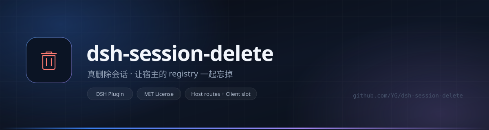
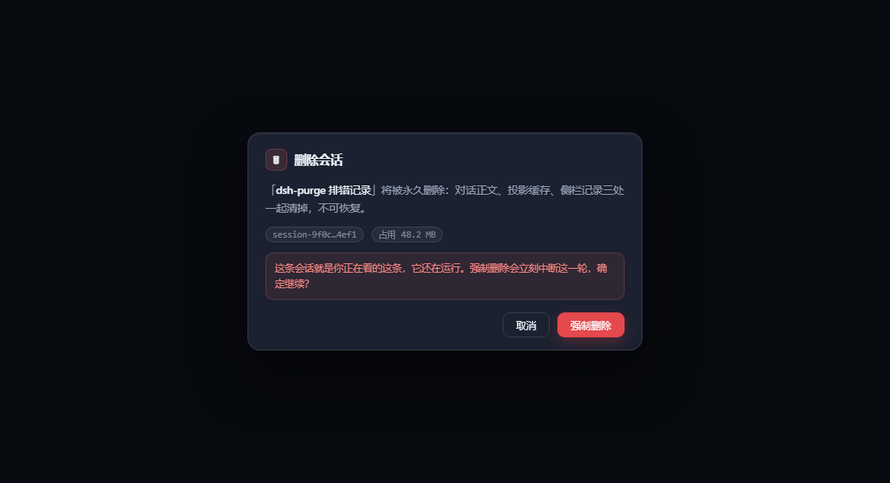

<div align="center">



<h1>dsh-session-delete</h1>

<p>
  <b>A delete button that actually deletes DSH sessions</b><br/>
  <sub>not archive — remove</sub>
</p>

<p>
  <a href="https://github.com/xffwlkjgzs88/dsh-session-delete/stargazers"></a>
  <a href="LICENSE"></a>
  <a href="DISCLAIMER.md"></a>
  <a href="#compatibility"></a>
  <a href="https://wpa.qq.com/msgrd?v=3&amp;uin=811588817&amp;site=qq&amp;menu=yes"></a>
</p>

<p>
  <b>English</b> · <a href="README.md">简体中文</a>
</p>

</div>

---



> [!IMPORTANT]
> **Two UI changes before you install:**
>
> 1. A bin icon on session rows (the actual feature).
> 2. The sidebar's "new version" indicator is hidden and replaced by an "App update" row under Settings → General.
>
> To opt out of #2, run `localStorage.setItem('dsh.session-delete.hideUpdateBadge', '0')` in DevTools and reload. Only applies to the desktop build with a real updater bridge; the web build is untouched.

## Why this exists

DSH only archives sessions; there is no delete. The obvious workaround is removing the session directory under `~/.dsh/sessions/`. It looks fine for a minute, then the session reappears — and after a restart it is back for good.

The reason took a night to find: `WorkspaceRegistry` keeps the whole sidebar state **in memory**. Deleting files doesn't tell it anything, and the next write flushes that in-memory state back over `workspace.json`, bringing the removed `sessionId` along. The backups showed it plainly:

```text
12:48:57  workspace.json: (empty)                    plugin deleted it
12:49:14  workspace.json: host flush, updatedAt      host writes back
12:49:20  workspace.json: d2f98c9f, 3caf4ef1         deleted ids are back
```

So the order here is inverted: make the host forget first, touch the disk second, then watch for a few seconds in case it writes back.

## What happens when you delete one

1. A running session is stopped first, then 300 ms for the last flush to land.
2. Detach from `SessionStore`, firing `session/disposed`.
3. `detachSession(id)` on every workspace entity, plus cleaning `archived` / `pinned`.
4. Remove `sessions/<bucket>/<id>/` and the projection cache JSON.
5. `emit('api-session/removed')` so the row drops immediately.
6. Re-check at 1.2 s and 4 s; if the id came back, clean it again.

Without the `workspaceRegistry` service it falls back to rewriting `workspace.json` and keeps a timestamped backup. It never double-writes when the service is present.

## Install

> Step-by-step beginner walkthrough (with copy-paste JSON) lives in the [Chinese README](README.md#三分钟上手不想动脑就照这个做).

### Let an AI do it

Open a new session in DSH and send:

> Install GitHub `xffwlkjgzs88/dsh-session-delete` into DSH: add the dependency and bundle entry to my profile's `package.json`, run `npm install`, restart, then confirm `/session-delete/ping` answers.

### Manual

```jsonc
{
  "dependencies": { "dsh-session-delete": "github:xffwlkjgzs88/dsh-session-delete" },
  "dsh": { "profile": { "bundles": ["…existing…", "dsh-session-delete"] } }
}
```

`npm install` in that profile directory, then restart DSH. Verify with `/session-delete/ping` → `{"ok":true,...,"version":"0.3.5"}`.

## Two UI changes, both disclosed

**1. The bin icon on session rows.** Click twice, session is gone.

**2. The "new version" indicator moves.** The plugin hides the native update badge at the bottom-left of the sidebar (the button whose class ends in `_indicator`) and adds an equivalent "App update" row under **Settings → General**, right below the current version. States are identical (checking / downloading n% / verifying / ready) and the update flow is untouched — it still calls `globalThis.dshDesktop.updates`.

Don't want that second change? Run once in the DevTools console and reload:

```js
localStorage.setItem('dsh.session-delete.hideUpdateBadge', '0')
```

## API

```http
GET  /session-delete/ping              → {"ok":true,"home":"…","version":"0.3.5"}
GET  /session-delete/state             → registry view vs. on-disk view
GET  /session-delete/size?sessionId=…  → bytes this session occupies
POST /session-delete/delete            → {"sessionId":"…"} or {"sessionId":"…","force":true}
```

| Result | Response |
|---|---|
| Deleted | `200` + `steps` |
| Running, no force | `409 {"code":"running","current":true}` |
| Running, force | `202`, executed 60 ms later |
| Bad id / bad method | `400` / `405` |

Details: [docs/api.md](docs/api.md), internals: [docs/internals.md](docs/internals.md).

## Compatibility

What has actually been checked — not a support matrix:

| | Value | Level |
|---|---|---|
| DSH | 0.2.0-rc.2 desktop | **ran for real** |
| Plugin | 0.2.0 | running on this machine, `/ping` reports it |
| Plugin | 0.3.5 (this repo) | **static only**: `node --check` + 4 unit tests; UI not re-run locally |
| OS | Windows 11 | real machine |

Unverified: web build, DSH 0.1.x, macOS / Linux, future versions.

Rough verdict: 0.2.0-rc.2 → works; other 0.2.x → probably; 0.1.x → don't; 0.3.x+ → unknown.

Failure is graceful, never fatal:

| Missing | Behaviour |
|---|---|
| `workspaceRegistry` | falls back to rewriting `workspace.json` (backed up) |
| `sessions` | skips detach |
| `webServer` (headless / TUI) | host half never loads |
| slot name changed | button never appears |

Self-check: `/ping` answers? host half alive. `/state` → `registry: service` = primary path, `file-only` = degraded.

## FAQ

**Web or desktop build?** EXE icon → `desktop` profile; `dsh web` in a terminal → `web` profile.

**Where is `~/.dsh`?** Windows: `C:\Users\<you>\.dsh`. macOS: `/Users/<you>/.dsh`.

**No button after install?** Open `/ping`. 404 → not loaded (check `bundles`, restart). Answers but no button → slot name mismatch.

**Does it phone home?** No. It only reads and writes files under `~/.dsh`; there is no outbound request in `lib/index.js`.

**Can I undo a delete?** No. Back up `~/.dsh/sessions` first.

**Does it break DSH updates?** No — it only relocates the entry point.

## Known issues

- Slot names are hard-coded; a rename makes the button disappear silently.
- Hiding the update badge relies on the `_indicator` class suffix.
- No de-duplication for concurrent deletes of the same id.

## Read before use

**Deletion is permanent.** Back up first. The routes are unauthenticated — never expose the DSH web port publicly. Full terms: [DISCLAIMER.md](DISCLAIMER.md).

## Author

**小富富 (Xiao Fufu)** · QQ **811588817**

Available for website / mini-program build and deployment, servers, domains, and payment API integration. Bug reports: include `/session-delete/state` output.

## License

[MIT](LICENSE) © 小富富
