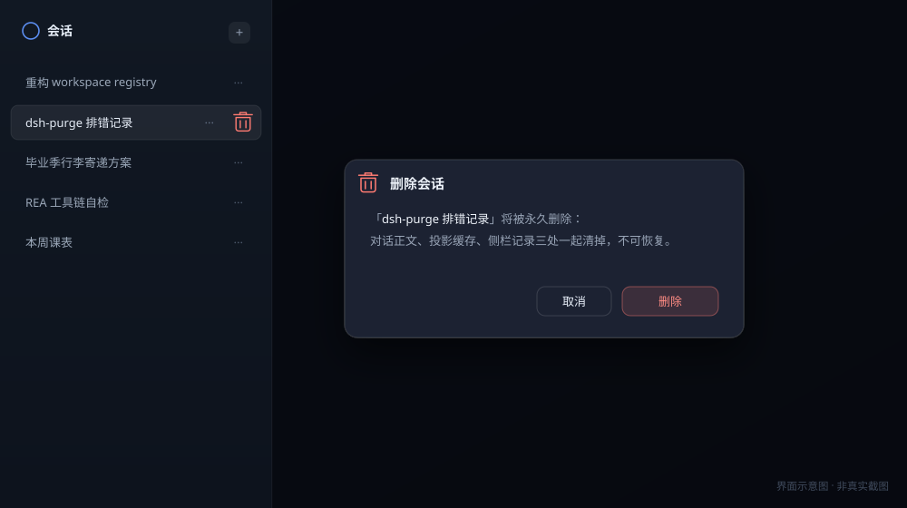

<div align="center">


<h1>dsh-session-delete</h1>

<p>
  <b>给 DSH 的会话列表加一个能真删的按钮</b><br/>
  <sub>不是归档，是删掉</sub>
</p>

<!-- 替换仓库 owner 时，这几行一起改 -->
<p>
  <a href="https://github.com/xffwlkjgzs88/dsh-session-delete/stargazers"></a>
  <a href="LICENSE"></a>
  <a href="DISCLAIMER.md"></a>
  <a href="#兼容性"></a>
  <a href="#兼容性"></a>
  <a href="https://wpa.qq.com/msgrd?v=3&amp;uin=811588817&amp;site=qq&amp;menu=yes"></a>
</p>

<p>
  <a href="README.en.md">English</a> · <b>简体中文</b>
</p>

</div>

---



## 起因

DSH 侧栏只有归档，没有删除。我一开始的做法很粗暴：直接去 `~/.dsh/sessions/` 把会话目录删了。

删完看着确实没了。过几分钟又冒出来，重启之后更是原样回来。

翻了一晚上才搞明白：宿主的 `WorkspaceRegistry` 把整份侧栏状态握在内存里，你动磁盘它根本不知道。只要它再写一次盘，整份内存状态就覆盖回去，被删掉的 `sessionId` 自然跟着回来。备份里留过一份现场：

```text
12:48:57  workspace.json: (空)                      插件删成功
12:49:14  workspace.json: 宿主写回，updatedAt 变了   宿主刷盘
12:49:20  workspace.json: d2f98c9f, 3caf4ef1        删掉的 id 又在了
```

所以这个插件的顺序是反的：先让宿主把那几条会话忘掉，再动文件，最后盯几秒看它会不会被写回来。

## 删一条会话时，里面发生了什么

1. 会话在跑就先停活（`archiveSession({ stopActivity: true })`），等 300ms 让最后一段写盘落完；
2. 从 `SessionStore` detach，触发 `session/disposed`；
3. 每个 workspace 实体 `detachSession(id)`，顺手把 archived / pinned 里残留的 id 剔掉；
4. 删 `sessions/<bucket>/<id>/` 和 `storages/session_projcache/sessions/<id>.json`；
5. `emit('api-session/removed')`，浏览器列表立刻掉行，不用整页刷新；
6. 1.2 秒和 4 秒各复核一次，发现被写回就地再清一遍。

拿不到 `workspaceRegistry` 服务的时候（宿主改了注册名、或者在 headless 环境里），才退回直接改 `workspace.json`，动手前存一份 `workspace.json.bak-<时间戳>`。服务在就绝不双写 —— 两个写者抢同一份 JSON，只会更难查。

## 安装

Node.js 18 以上，DSH 0.2 以上。改完必须重启 DSH，插件是启动时加载的。

web 版改 `~/.dsh/profiles/web/package.json`，桌面版改 `desktop` 那份。加两处：

```jsonc
{
  "dependencies": {
    "dsh-session-delete": "github:xffwlkjgzs88/dsh-session-delete"
  },
  "dsh": {
    "profile": {
      "bundles": ["…原有的…", "dsh-session-delete"]
    }
  }
}
```

同目录 `npm install`，重启。

装没装上，访问一下就知道：

```text
http://127.0.0.1:19387/session-delete/ping
{"ok":true,"home":"C:\\Users\\you\\.dsh","version":"0.2.0"}
```

不想挂 git 也行：Release 页有 `dsh-session-delete-0.2.0.tgz`，`npm pack` 自己打一个也行，用 `file:` 引进来；或者把目录直接丢进 `node_modules/`，再在 `bundles` 里加一行。

> 客户端那一半靠宿主座位注入：`dsh.bundle.patch` 会自动带上 `cordis.patch.yml`，不用你去改 `cordis.yml`。

## 用起来

鼠标移到会话行上，`···` 右边会出现一个垃圾桶。

第一次点，按钮变红问「确认?」，3.5 秒内有效，过期自动复原。第二次点才真删，删完页面自己刷新。

如果这条会话还在跑 —— 包括你正看着的这条 —— 会先弹个框告诉你这一轮会被打断，确认了才动手。删当前会话时后端是**先回包再执行**的，不然响应发不出去，浏览器会一直转圈等超时。

## 接口

三条路由挂在 `/session-delete` 下，同源、无鉴权。

```http
GET  /session-delete/ping     → {"ok":true,"home":"…","version":"0.2.0"}
GET  /session-delete/state    → 宿主认为有什么 vs 磁盘上实际有什么
POST /session-delete/delete   → {"sessionId":"…"} 或 {"sessionId":"…","force":true}
```

`/delete` 的几种返回：

| 情况 | 返回 |
|---|---|
| 正常删完 | `200` + `steps` 逐步结果 |
| 会话在跑，没带 force | `409 {"code":"running","current":true}` |
| 会话在跑，带了 force | `202`，60ms 后后台执行 |
| sessionId 不合法 | `400` |
| 方法不对 | `405` |

`steps` 里哪一步没成功会写成 `fail: 原因`，不会假装成功。

排错基本就靠 `/state`：它把 registry 里的 `sessionIds`、`sessions/` 下实际有哪些目录、投影缓存里有哪些 id 并排列出来，对一眼就知道卡在哪一层。参数细节见 [docs/api.md](docs/api.md)，内部时序见 [docs/internals.md](docs/internals.md)。

## 兼容性

| | |
|---|---|
| DSH web（`dsh web`，profile `web`） | 0.2.x 上跑过 |
| DSH 桌面版（EXE，profile `desktop`） | 同一套路由和按钮 |
| Node.js | ≥ 18 |
| 系统 | Windows / macOS 实测过；Linux 路径逻辑一样但没跑 |
| 第三方依赖 | 没有 |

## 已知问题

- **座位名是写死的。** 按钮挂 `sidebar.workspaces.session.row.action`，弹窗挂 `shell.overlay`。DSH 哪天改名，按钮会静默消失（`ctx.slots.inject` 不抛错）。改 `lib/client.js` 顶部两个常量即可。
- **并发删同一个 id 没有去重。** 宿主那边也没为这个场景做保护，别高频对同一条疯狂点。
- **只在 0.2.x 上跑过。** 更老的 DSH 需要对应老版本插件。
- **`workspace.json` 的退路只做了「删 id」，没做结构迁移。** 宿主以后改 JSON 结构的话，这条退路会先坏。

## 用户须知

先说清楚：**这个插件删东西不进回收站。**

- 删了就是删了，没有软删除，没有撤销，我也找不回来。
- `force` 的强制删除会打断那条会话正在跑的回合；删的是当前会话的话，你眼前这一轮就断了。
- 用之前建议先把 `~/.dsh/sessions` 和 `storages/workspace.json` 拷一份，出事了还能回滚。
- **别把 DSH 的 web 端口开到公网。** 这三条路由没鉴权，谁都能 POST，等于把删除按钮挂在公网上。
- 用这个插件造成的数据丢失、工作中断、业务损失，作者不承担责任。完整条款在 [DISCLAIMER.md](DISCLAIMER.md)，不同意就别装。

## 关于作者

**小富富** · QQ **811588817**

- 插件本身的问题：先看上面「已知问题」，再把 `/session-delete/state` 的返回和 `steps` 贴过来，加 QQ 说也行。
- 接活：网站、小程序搭建与部署，服务器、域名、支付接口对接，一条龙。校园项目、企业内部工具、要对接物流或支付的，都可以聊。

## 许可

[MIT](LICENSE) © 小富富

<div align="center">
  <a href="https://star-history.com/#xffwlkjgzs88/dsh-session-delete&Date">
    
  </a>
</div>
