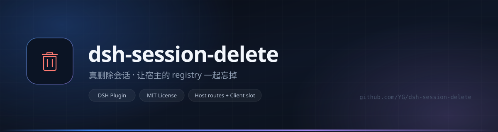
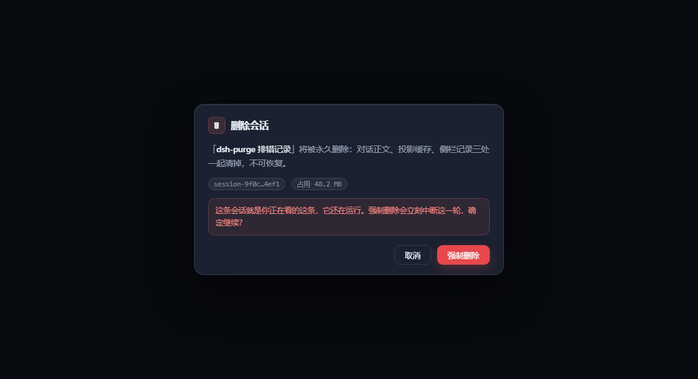

<div align="center">



<h1>dsh-session-delete</h1>

<p>
  <b>给 DSH 的会话列表加一个能真删的按钮</b><br/>
  <sub>不是归档，是删掉</sub>
</p>

<p>
  <a href="https://github.com/xffwlkjgzs88/dsh-session-delete/stargazers"></a>
  <a href="LICENSE"></a>
  <a href="DISCLAIMER.md"></a>
  <a href="#兼容性"></a>
  <a href="#兼容性"></a>
  <a href="https://wpa.qq.com/msgrd?v=3&amp;uin=811588817&amp;site=qq&amp;menu=yes"></a>
</p>

<p>
  <a href="README.en.md">English</a> · <b>简体中文</b>
</p>

<p>
  <sub>
    <b>作者接活</b>：网站 / 小程序搭建与部署 · 服务器 · 域名 · 支付接口对接，一条龙<br/>
    <a href="https://wpa.qq.com/msgrd?v=3&amp;uin=811588817&amp;site=qq&amp;menu=yes">QQ 811588817</a>（加时注明来意）
  </sub>
</p>

</div>

---



> [!IMPORTANT]
> **装之前先看清楚：这个插件会改动你界面的两处地方。**
>
> 1. **会话行多一个垃圾桶** —— 这是主功能，两次点击删除。
> 2. **侧栏左下角的「新版本」按钮会被隐藏**，改为「设置 → 通用」里的一行「版本更新」。
>
> 第 2 条不属于删除功能，是顺手做的界面调整。**不想要**：在 DSH 开发者工具 Console 里执行
> `localStorage.setItem('dsh.session-delete.hideUpdateBadge', '0')`，刷新页面，原生按钮立刻回来。
> 只在桌面版、且宿主确实提供了更新桥时才会动它；web 版不会碰。
> 细节见下面「[它一共改了两处界面](#它一共改了两处界面)」。

## 起因

DSH 侧栏只有归档，没有删除。

我这人有点强迫症，看着那串越来越长的归档列表就膈应 —— 那些会话我根本不会再打开，可它们还在硬盘上占着地方。归档不是删除，它只是把东西塞进抽屉，抽屉还是会满。

一开始的做法很粗暴：直接去 `~/.dsh/sessions/` 把会话目录删了。

删完看着确实没了。过几分钟又冒出来，重启之后更是原样回来。

翻了一晚上才搞明白：宿主的 `WorkspaceRegistry` 把整份侧栏状态握在内存里，你动磁盘它根本不知道。只要它再写一次盘，整份内存状态就覆盖回去，被删掉的 `sessionId` 自然跟着回来。备份里留过一份现场：

```text
12:48:57  workspace.json: (空)                      插件删成功
12:49:14  workspace.json: 宿主写回，updatedAt 变了   宿主刷盘
12:49:20  workspace.json: d2f98c9f, 3caf4ef1        删掉的 id 又在了
```

所以这个插件的顺序是反的：先让宿主把那几条会话忘掉，再动文件，最后盯几秒看它会不会被写回来。

## 删一条会话时，里面发生了什么

1. 会话在跑就先停活（`archiveSession({ stopActivity: true })`），等 300ms 让最后一段写盘落完；
2. 从 `SessionStore` detach，触发 `session/disposed`；
3. 每个 workspace 实体 `detachSession(id)`，顺手把 archived / pinned 里残留的 id 剔掉；
4. 删 `sessions/<bucket>/<id>/` 和 `storages/session_projcache/sessions/<id>.json`；
5. `emit('api-session/removed')`，浏览器列表立刻掉行，不用整页刷新；
6. 1.2 秒和 4 秒各复核一次，发现被写回就地再清一遍。

拿不到 `workspaceRegistry` 服务的时候，才退回直接改 `workspace.json`，动手前存一份 `workspace.json.bak-<时间戳>`。服务在就绝不双写 —— 两个写者抢同一份 JSON，只会更难查。

## 安装

### 一、让 AI 帮你装（推荐）

**在 DSH 里新开一个会话**，把下面这段原样发给它 —— 就是你现在正在用的这个 AI，它自己会找路径、改配置、跑安装：

```text
帮我安装 DSH 插件 dsh-session-delete（GitHub: xffwlkjgzs88/dsh-session-delete），按顺序做：

1. 判断版本：~/.dsh/profiles/web 存在就是 web 版，~/.dsh/profiles/desktop 存在就是桌面版。
   两个都在就问我，别自己猜。
2. 备份该目录的 package.json，命名 package.json.bak-before-session-delete。
3. dependencies 里加：
   "dsh-session-delete": "github:xffwlkjgzs88/dsh-session-delete"
4. dsh.profile.bundles 数组末尾加 "dsh-session-delete"。
5. 在该目录执行 npm install；如果我这台机器没有 npm，就改成下载仓库 zip，
   解压成 node_modules/dsh-session-delete（这个插件没有任何依赖，直接拷进去就能跑）。
6. 告诉我怎么重启 DSH（退出进程再打开，不用重启电脑、不用更新客户端）。
7. 重启后让我访问 http://127.0.0.1:19387/session-delete/ping ，
   返回 {"ok":true,...} 就算成功；报错就把错误和 package.json 发给我。

限制：不要升级 Node，不要升级 DSH，除上面两处外不要改任何字段。
```

### 二、自己动手

改 `~/.dsh/profiles/web/package.json`（web 版）或 `~/.dsh/profiles/desktop/package.json`（桌面版），两处：

```jsonc
{
  "dependencies": {
    "dsh-session-delete": "github:xffwlkjgzs88/dsh-session-delete"
  },
  "dsh": {
    "profile": {
      "bundles": ["…原有的…", "dsh-session-delete"]
    }
  }
}
```

同目录 `npm install`，重启 DSH。

**没有 Node / npm 也能装**：这插件零依赖，把仓库 ZIP 下下来解压，改名成 `dsh-session-delete` 丢进 `node_modules/`，再在 `bundles` 里加一行，效果一样。

### 三、确认装上了

```text
http://127.0.0.1:19387/session-delete/ping
{"ok":true,"home":"C:\\Users\\you\\.dsh","version":"0.3.2"}
```

## 用起来

鼠标移到会话行上，`···` 右边会出现一个垃圾桶。

第一次点，按钮变红问「确认?」，3.5 秒内有效，过期自动复原。第二次点才真删，删完页面自己刷新。

弹窗里会告诉你这条会话占多少磁盘，删之前心里有个数。

如果这条会话还在跑 —— 包括你正看着的这条 —— 会先弹框说这一轮会被打断，确认了才动手。删当前会话时后端**先回包再执行**，不然响应发不出去，浏览器会一直转圈等超时。

## 它一共改了两处界面

第一次装的人容易只看到删除按钮，其实还有一处 —— 这处必须说明白，不然算背着人动东西。

**第一处：会话行的垃圾桶。** 就是上面说的那个，点两次删掉。

**第二处：把侧栏左下角的「新版本」提示搬进了设置。**

- 原来那个小按钮（侧栏左下角、带小红点、类名以 `_indicator` 结尾的那个）会被隐藏；
- 取而代之，在「设置 → 通用 → 当前版本」下面多一行「版本更新」，文案和状态跟原生完全一致：检查中、下载中 x%、校验中、准备重启、安装并重启；
- **更新逻辑一点没改**，还是调 `globalThis.dshDesktop.updates` 那套原生桥，只是换了入口位置；
- **只在桌面版、且宿主确实提供了 `dshDesktop.updates` 时才生效**。web 版没有这个桥，插件不会隐藏任何按钮 —— 藏掉又没有替代入口，等于给你添乱。

不想要这个改动？两种关法：

```js
// 在 DSH 的开发者工具 Console 里执行一次，刷新页面即可，原生按钮会回来
localStorage.setItem('dsh.session-delete.hideUpdateBadge', '0')
```

或者改代码：删掉 `lib/client.js` 里 `apply()` 末尾那行 `installUpdateIndicatorHider()`。删完设置里那行还在，不影响使用。

## 接口

四条路由挂在 `/session-delete` 下，同源、无鉴权。

```http
GET  /session-delete/ping              → {"ok":true,"home":"…","version":"0.3.2"}
GET  /session-delete/state             → 宿主认为有什么 vs 磁盘上实际有什么
GET  /session-delete/size?sessionId=…  → 这条会话占多少字节
POST /session-delete/delete            → {"sessionId":"…"} 或 {"sessionId":"…","force":true}
```

`/delete` 的几种返回：

| 情况 | 返回 |
|---|---|
| 正常删完 | `200` + `steps` 逐步结果 |
| 会话在跑，没带 force | `409 {"code":"running","current":true}` |
| 会话在跑，带了 force | `202`，60ms 后后台执行 |
| sessionId 不合法 | `400` |
| 方法不对 | `405` |

`steps` 里哪一步没成功会写成 `fail: 原因`，不会假装成功。参数细节见 [docs/api.md](docs/api.md)，内部时序见 [docs/internals.md](docs/internals.md)。

## 兼容性

先把话说明白：**下面是"验证到什么程度"，不是"支持什么版本"**。

| 项目 | 值 | 验证程度 |
|---|---|---|
| DSH | 0.2.0-rc.2 桌面版（EXE FileVersion 0.2.0-rc.2） | **实际运行验证** |
| 插件 | 0.2.0 | 在本机 DSH 里跑着，`/session-delete/ping` 返回 `"version":"0.2.0"` |
| 插件 | 0.3.2（本仓库当前版本） | **只做了静态验证**：`node --check` + 4 条单测通过；界面与删除流程没有在本机重跑（升级需重启 DSH，会打断当前会话） |
| 系统 | Windows 11 | 实机 |
| Node | 24.x | 只影响 `npm install`，运行用 DSH 自带运行时 |

自己验证的最快方式：装完看 `/session-delete/ping` 返回的 `version`，那就是你实际跑着的版本。

没验证过的：web 版具体构建号、0.1.x 老版本、macOS / Linux、以及以后的新版本。

| 你的版本 | 判断 |
|---|---|
| DSH 0.2.0-rc.2（桌面） | 直接可用，就是开发环境 |
| DSH 0.2.x 其它构建（web / 桌面） | 大概率可用，前提是宿主还提供 `workspaceRegistry`、`sessions`、`webServer` 和那两个座位名 |
| DSH 0.1.x | 别装。服务名和座位体系都不一样，装了按钮也不会出现 |
| DSH 0.3.x 及以后 | 未知。宿主改了服务名或座位名就会静默失效 |

失效时不会崩，只是降级。四种缺东西的情况：

| 缺什么 | 实际表现 |
|---|---|
| `workspaceRegistry` 拿不到 | 退回直接改 `workspace.json`（先备份），功能照常 |
| `sessions` 拿不到 | 跳过 detach，其余步骤照做 |
| `webServer` 没有（headless / TUI） | 宿主半边整块不加载，静默 |
| 座位名改了 | 按钮不出现，不报错 |

装完想确认自己这版能跑，看两个地址：

```text
/session-delete/ping    → 有返回 = 宿主半边活着
/session-delete/state   → registry 是 service 走主路；file-only 在降级；absent 服务没拿到
```

## 常见问题

**我到底是 web 版还是桌面版？**
装了 EXE、双击图标启动的就是桌面版，配置目录 `~/.dsh/profiles/desktop`；用命令行 `dsh web` 开浏览器的是 web 版，目录是 `web`。

**`~/.dsh` 在哪？**
Windows 是 `C:\Users\你的用户名\.dsh`，地址栏直接粘 `%USERPROFILE%\.dsh` 回车就到。macOS 是 `/Users/你的用户名/.dsh`。

**改完没反应，按钮没出现？**
先开 `/session-delete/ping`：

- 404 或打不开 → 插件没加载，八成是 `bundles` 里漏了、或者没重启 DSH；
- 有返回但没按钮 → 座位名对不上，把 `/state` 输出和 DSH 版本发出来。

**会不会把我的聊天内容传出去？**
不会。插件只在本机读写 `~/.dsh` 下的文件，代码里没有任何外发请求，你可以自己翻 `lib/index.js`。

**删掉的能恢复吗？**
不能，也没有回收站。所以第一次用之前先备份 `~/.dsh/sessions` 和 `storages/workspace.json`。

**会不会影响 DSH 自己更新？**
不会。它只是把更新入口从侧栏挪到设置里，走的还是官方那套更新桥，见上面「它会改动的两处界面」。

**升级 DSH 之后插件还在吗？**
`~/.dsh` 里的东西不会被升级清掉，但升级完要重启一次。如果新版本改了座位名，按钮会消失，那就只能等适配。

**装了会不会占很多空间？**
插件本身 30KB 左右，零依赖。它是来帮你腾空间的，不是来占空间的。

## 已知问题

- **座位名写死。** 按钮挂 `sidebar.workspaces.session.row.action`，弹窗挂 `shell.overlay`。宿主改名后按钮静默消失，改 `lib/client.js` 顶部两个常量就行。
- **隐藏更新按钮靠类名后缀判断。** 现在认 `_indicator` 结尾的按钮，宿主换构建哈希也能认；但如果哪天连类名都换了，这个功能会失效（不影响删除）。
- **并发删同一个 id 没有去重。** 别对同一条疯狂点。
- **`workspace.json` 退路只删 id，不做结构迁移。** 宿主改 JSON 结构的话，这条退路会先坏。

## 用户须知

**这个插件删东西不进回收站。**

- 删了就是删了，没有软删除、没有撤销，我也找不回来。
- `force` 的强制删除会打断那条会话正在跑的回合；删的是当前会话的话，你眼前这一轮就断了。
- 用之前建议先把 `~/.dsh/sessions` 和 `storages/workspace.json` 拷一份。
- 它会改界面：加一个删除按钮，并在桌面版隐藏侧栏的「新版本」按钮（可在 Console 关掉，见文首提示）。
- **别把 DSH 的 web 端口开到公网。** 这四条路由没鉴权，谁都能 POST，等于把删除按钮挂在公网上。
- 它不联网、不收集数据，只在本机读写 `~/.dsh`。
- 作者对数据丢失、工作中断、业务损失不承担赔偿责任，也没有响应时限义务。完整条款（含界面改动、数据处理、责任限制、可分割性）在 [DISCLAIMER.md](DISCLAIMER.md)。

## 关于作者

**小富富** · QQ **811588817**

写这个插件纯粹因为自己用着膈应，顺手做的。更新不一定勤，但有问题会看。

另外接活，做了六七年了：

| 做什么 | 具体一点 |
|---|---|
| 网站 / 小程序 | 商城、企业站、预约、分销、后台管理，能搭也能改 |
| 部署一条龙 | 服务器、域名、备案、HTTPS、环境、上线后运维 |
| 支付对接 | 微信支付、支付宝、聚合通道，能把资质到回调跑通 |
| 企业内工具 | 内部系统、数据看板、对接现有 ERP / 物流 / 短信 |

加 QQ 直接说需求就行，不用客套。插件本身的问题也欢迎，但先看上面的「常见问题」和「兼容性」。

## 许可

[MIT](LICENSE) © 小富富

<div align="center">
  <a href="https://star-history.com/#xffwlkjgzs88/dsh-session-delete&Date">
    
  </a>
</div>
